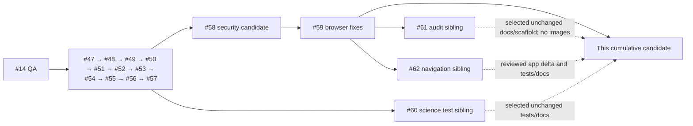

# NPDB cumulative integration candidate — 5 November 2026 JST

Status: review candidate only. Production restore and release approval BLOCKED. New branch `qa/npdb-cumulative-integration-20261105` starts exactly at #59 `272d502d6812f62bbb20acd2cf3106b203c0ea1c`. The exact tested candidate SHA is the PR head and the immutable GitHub Actions run head_sha, printed with git rev-parse HEAD; source heads below are frozen inputs, not claims that their commits were merged.

## Dependency map

| PR | Exact source head | Branch | Target base |
|---|---|---|---|
| #14 | `606ba8f7decdd3767a93b64ac8a3a2896d6e8bd9` | `qa/npdb-reviewed-integration-20261103` | `main` |
| #47 | `35c0d583eb8f3a63681acdb21d6467535451bbc0` | `qa/npdb-integrated-preflight-20261103` | `qa/npdb-reviewed-integration-20261103` |
| #48 | `0fd7f4018cf5ce3bfe4e982e3d6f5b019ddd4904` | `fix/npdb-preflight-security-validation-20261103` | `qa/npdb-integrated-preflight-20261103` |
| #49 | `fb0d58c32b0feec66d53736a8e06ae2d441f67d8` | `fix/npdb-retina-sidebar-logo-20261103` | `fix/npdb-preflight-security-validation-20261103` |
| #50 | `e0f02166013f3f6efdca986b4f8b4c391d0ad731` | `fix/npdb-branding-asset-cache-20261103` | `fix/npdb-retina-sidebar-logo-20261103` |
| #51 | `ab1720a0e819c0ed5cff1a381dde6ab82f6ef4c3` | `fix/npdb-structure-bundle-provenance-20261103` | `fix/npdb-branding-asset-cache-20261103` |
| #52 | `08402261312fed40ae657350d176bec5df4e7e15` | `fix/npdb-scientific-truthfulness-20261103` | `fix/npdb-structure-bundle-provenance-20261103` |
| #53 | `2e884ed9f45f6da43decdb61f5c60b4742d5662f` | `fix/npdb-nmr-bioactivity-disclosure-20261103` | `fix/npdb-scientific-truthfulness-20261103` |
| #54 | `9a2091d07fb64c36bda65c2905d44dc0cc2e7cba` | `fix/npdb-security-integrity-gates-20261103` | `fix/npdb-nmr-bioactivity-disclosure-20261103` |
| #55 | `eff14ad74ca2b07416492d2371b366259319a94a` | `fix/npdb-pandas-deployment-envelope-20261103` | `fix/npdb-security-integrity-gates-20261103` |
| #56 | `02484b64196e191b067ebcf3715651126cfa0e72` | `fix/npdb-stereo-aware-structure-search-20261103` | `fix/npdb-pandas-deployment-envelope-20261103` |
| #57 | `fee5d3fdc021d2f7c21112f85cde2a24a00f85fe` | `fix/npdb-asset-read-auth-review-20261105` | `fix/npdb-stereo-aware-structure-search-20261103` |
| #58 | `4e663656ea98f9aaf9f201916610739623b9af7f` | `qa/npdb-security-candidate-20261105` | `qa/npdb-reviewed-integration-20261103` |
| #59 | `272d502d6812f62bbb20acd2cf3106b203c0ea1c` | `fix/npdb-browser-qa-followup-20261105` | `qa/npdb-security-candidate-20261105` |
| #60 | `ea4d5ec5b6dfe6b85761f378464585eccdd01149` | `test/npdb-science-round2-integration-20261105` | `fix/npdb-asset-read-auth-review-20261105` |
| #61 | `2c7d82192a4b6ebd3b6295d8031e57aad13273bf` | `docs/npdb-uiux-handoff-integration-20261105` | `fix/npdb-browser-qa-followup-20261105` |
| #62 | `ca526e1902b23f4aa3cbfa98657d81688324bdca` | `fix/npdb-nmr-result-navigation-20261105` | `fix/npdb-browser-qa-followup-20261105` |

#58 already contains the cumulative earlier security stack. #60 was based on #57; it does not contain #58/#59. #61 and #62 are siblings based on #59. This candidate selects their final files; it does not merge their branches, replay their duplicate workflow edits, retarget older drafts or change main. Historical #20/#35/#38 were parallel/superseded and are not independently mergeable; equivalent integrated functionality and legacy shadowed definitions remain documented in NPDB_CUMULATIVE_CANDIDATE_20261105.md. No old feature branch or old report-branch application history imported.

## Selection and conflict resolution

- #62: app.py scoped callback changes for NMR result actions, native positional indices for two record destinations, four full-script synthetic integration tests and navigation review. Application diff is byte-for-byte identical to #62 ca526e1 relative to #59. No additional algorithm, UI/theme, authorization or schema edits. Initial #62 CI failure remains recorded in its report.
- #61: audit report, aggregate measurements, loopback/synthetic browser scaffold with redirect guard, import safety review. All 13 screenshots remain excluded for #43 disclosure/provenance review. Historical #56 measurements are author evidence, not current-candidate browser results.
- #60: unchanged 45-case synthetic science test file, scientific report, import review and strict reproduction runner. No desired test removed, renamed, weakened or changed to skip. Green failure-reproduction status is never scientific acceptance.
- CI: retained #59 configuration, added only this branch to six push triggers; adopted strict reproduction and Streamlit wildcard once, plus node syntax check. Did not copy redundant sibling trigger edits. No merge conflicts or silent overwrites: new paths were required absent; app patch passed git apply --check. All eleven selected files match frozen source heads; SHA256 provenance is in CUMULATIVE_INTEGRATION_SOURCES_20261105.json.
- Ownership: source integration claimed on Issue #17 after reading coordination6641971458 and independent PR #62 review5775714114. Claim released after integration commit. Independent review is still required; this engineer's reconciliation is not external approval.

## Test matrix and reproducibility

All tests use synthetic fixtures; no production secrets, data, private object bytes or real backups. Six existing workflows run against this branch on push, resolving its exact commit, rather than assuming individual PR CI covers their combination. No new dependencies or paid infrastructure.

| Layer | Runtime / command | Evidence and boundary |
|---|---|---|
| Static | Python compile/compileall; node --check tests/ui/npdb_uiux_acceptance.js; git diff --check | Source/syntax only; not browser or backend proof |
| Offline matrix | Python3.11 and3.12, pandas2.2.3, RDKit2026.9.1, Pillow/openpyxl as pinned in workflow; unittest discover test_*.py | Combined expected discovery310; Streamlit-dependent tests may skip in offline jobs without Streamlit, disclosed in logs |
| Scientific strict reproduction | scripts/verify_science_round2_failures.py, NPDB_STRICT_DESIRED=1 | Exactly45 tests,16 AssertionErrors,zero errors/skips required; shell success certifies reproduction only |
| Full pinned suite | Python3.12, Streamlit1.66.1, pandas2.2.3, RDKit2026.9.1, Plotly7.1.0, Pillow12.3.0, openpyxl3.1.5; Retina/full workflow | Expected310 tests with16 xfails and no skips; CI must confirm exact totals |
| Full-script integration | Streamlit1.66.1 AppTest, test_streamlit_*integration.py |15 tests: login, recovery, revoked/rotated sessions, NMR3-mode navigation, editor/viewer/fresh-session controls. Disposable SQLite, no network |
| Security/privacy | Full suite plus dedicated GPS workflow on Python3.11/3.12 | Backend role/action/API/path/download/ZIP/GPS tests inherited; synthetic results do not attest deployed policies, free-text or historical attachments |
| Synthetic database | PostgreSQL workflow existing synthetic restore, role/RLS, integrity-default UP/DOWN tests | Isolated CI database only; not production dump, Auth/Storage restoration or production RLS certification |
| WAL/cache | Existing WAL snapshot workflow, structure index/cache tests in full suite | Real synthetic SQLite concurrent/WAL and cache checks; no real backup files |
| Dependency gate | Existing pandas-envelope workflow | Supported pandas boundary retained; no requirements changed |
| Real browser | Imported scaffold not run during integration | BLOCK: keyboard/focus/contrast/reflow/assistive technology, all dummy roles and real interaction checks required independently |

Reproduce from the immutable candidate: python -m unittest discover -s NMR_Database_Tyas_GitHub_Upload/tests -p 'test_*.py' -v; separately python NMR_Database_Tyas_GitHub_Upload/scripts/verify_science_round2_failures.py. Use the pinned workflow environments, not the host's Python3.14/Streamlit1.56/pandas3. Counts here are expectations until exact-SHA logs are recorded in the PR evidence comment.

## Sixteen unresolved scientific assertions

All original desired tests remain expectedFailure in ordinary execution; strict mode must reproduce each as AssertionError, not a harness error. This inventory includes confirmed limitations and policy proposals; names do not establish curator approval. Fingerprints cannot guarantee exact identity, and presence completeness does not mean validated scientific quality.

| # | Original test identifier | Unresolved finding / assumption |
|---|---|---|
| 1 | `StereoSearchLimitations.test_desired_every_single_centre_epimer_is_distinguishable_by_the_fingerprint` | Confirmed fingerprint limitation; exact identity must be separately determined, not guaranteed by a fingerprint. |
| 2 | `StereoSearchLimitations.test_desired_search_offers_connectivity_level_similarity_for_stereo_free_queries` | Confirmed recall limitation; connectivity retrieval policy requires scientific review. |
| 3 | `StereoSearchLimitations.test_desired_hits_state_their_stereo_relationship_to_the_query` | Missing relationship disclosure; labeling policy requires curator review (source assertion). |
| 4 | `StereoSearchLimitations.test_desired_search_results_flag_constitutional_isomers_of_the_query` | Missing relationship disclosure; proposal, not proof of constitution from formula (source assertion). |
| 5 | `NmrInputAndQuality.test_desired_processed_spectra_are_rejected_not_converted_into_peaks` | Confirmed JCAMP XYDATA misinterpretation; safe supported-format handling needed. |
| 6 | `NmrInputAndQuality.test_desired_hertz_peak_tables_are_converted_with_the_observe_frequency_or_rejected` | Confirmed Hz-as-ppm defect; validated nucleus/units/referencing needed. |
| 7 | `NmrInputAndQuality.test_desired_peak_widths_are_never_returned_as_peaks` | Confirmed JCAMP XYW width-as-peak defect. |
| 8 | `NmrInputAndQuality.test_desired_peaks_can_be_stored_as_explicitly_unassigned` | Confirmed enforced assignment; nullable/unassigned policy and schema review required, no migration here. |
| 9 | `NmrInputAndQuality.test_desired_nmr_entries_are_checked_against_the_molecular_formula` | Missing plausibility check; scientific review proposal, not automatic rejection/rewriting (source assertion). |
| 10 | `NmrInputAndQuality.test_desired_zero_tolerance_means_equality_at_reporting_precision` | Confirmed floating slack at zero; explicit reporting-precision policy required. |
| 11 | `BioactivityAndLabels.test_desired_unit_status_does_not_call_an_incompatible_unit_recorded_without_qualification` | Confirmed endpoint/unit disclosure gap; no unit invented. |
| 12 | `BioactivityAndLabels.test_desired_unit_vocabulary_contains_millimolar` | Missing mM vocabulary; must remain distinct from millimetre mm. |
| 13 | `BioactivityAndLabels.test_desired_outcome_vocabulary_distinguishes_inactive_from_not_tested` | Missing explicit untested state (source assertion); relation/outcome vocabulary needs review. |
| 14 | `BioactivityAndLabels.test_desired_completeness_never_reaches_100_for_unvalidated_content` | Policy/terminology proposal: presence completeness is not validation; do not silently redefine. |
| 15 | `BioactivityAndLabels.test_desired_viewer_text_does_not_claim_curation_for_all_records` | Confirmed broad curation wording (source assertion); no stored labels changed. |
| 16 | `BioactivityAndLabels.test_desired_manifest_states_licence_citation_and_export_version` | Confirmed manifest metadata gap; actual licensing/citation statements require approved provenance. |

## Remaining release gates and limits

- BLOCK: #24 genuine isolated production DB/roles/Auth/Storage restore, object integrity/readback, measured recovery procedure. Encrypted backup existence and synthetic restore CI do not prove this. No real backups accessed.
- BLOCK: #19/#23 independent browser acceptance on this exact integrated SHA. Review #62 correct record selection after search/filter/pagination, keyboard activation, revoked sessions, viewer/editor/owner controls and known resubmission-on-return behavior. Verify recovery opens/focuses without account enumeration or invented contact. Reported 768px clipping/click interception is unconfirmed; theme/focus/caption contrast/headings/alt/320–1920px reflow require separate work. Imported browser script is not complete role/security or accessibility acceptance; no browser screenshots generated here.
- BLOCK: all16 assertions above. SCI2-H3 parsing and H1/H2 connectivity/identity relationship corrections need separate narrow scientific review. H4,H7,H6/H10 and provenance/formula/evidence-tier/FAIR/licensing proposals not fixed. No scientific algorithm change in this candidate.
- BLOCK: #43 locality/depth/sample-code/date disclosure policy and historical free text/attachments/EXIF review; inherited GPS alias/export redaction tests do not certify all unpublished data paths. All13 supplied screenshots remain withheld.
- BLOCK: independent #17/#22 security gate acceptance. Synthetic tests exercise roles, stale sessions, API methods/signing, path containment/download/export, CAS and WAL/cache behavior; production conditional SELECT policies on public.import_batches/import_records, Storage/direct REST policy correctness and cross-session browser leakage are not independently certified by this integration. No production credentials or live API probes used.
- Proposed curation default migration inherited under docs remains unapplied; any production schema change requires verified restore and explicit authorization. Other legacy pandas index sites and shadowed definitions remain separate review risks. No speculative refactor in this PR.

## Review sequence and rollback

1. Independent integration reviewer checks #59 ancestry, source hashes/selection manifest, app.py equality with #62, no imported images/data/migrations and consolidated CI scope.
2. Independent backend/security reviewer examines the integrated role/action/storage/export/cache/CAS regressions and unresolved deployment-policy boundaries; science reviewer checks16-item inventory and safe interpretation of strict red reproduction.
3. Work/browser reviewer runs bounded isolated synthetic acceptance on the frozen candidate, with dummy roles, no cloud secrets/real files and durable per-page results. Review screenshots before sharing. Actual browser failures stay BLOCK; fix theme/scientific issues separately.
4. Re-run exact-tip CI after any reviewed adoption/change. No merge/deploy/release approval until independent restore and all acceptance gates clear. Earlier drafts remain intact for comparison; do not merge siblings independently into main.

Rollback before adoption: close this unmerged draft and return to frozen #59 272d502d6812f62bbb20acd2cf3106b203c0ea1c. If adopted onto a candidate branch, revert this integration commit only (no force-push or branch overwrite); inherited #59/#58 remain. This removes selected tests/docs and restores prior NMR navigation defect. No schema/data/credential rollback, restore or production action needed. Preserve original failed #62 run41910318534 as evidence; corrected #62 source CI alone is not integrated acceptance.
